💡 **一页看懂**

- **五层结构**：医保打底 → 单位核心/自选计划补小额 → 惠民保兜住高龄和带病家人 → 百万医疗抗大病自费 → 重疾险补收入损失。
- **家庭分工**：员工本人吃满单位福利并自补重疾和定寿；配偶单独买长期百万医疗和重疾；父母靠医保+惠民保+防癌医疗；孩子靠居民医保+百万医疗+少儿重疾。
- **理赔顺序铁律**：医保先结算 → 惠民保 → 单位团险 → 百万医疗，每报完一家开**理赔分割单**接力；重疾险凭确诊书单独给付，互不冲突。
- **企业团购的自费百万医疗**本质是团单渠道的百万医疗险，和市面个人百万医疗保的是同一类风险，靠它的免健告/可带家属优势覆盖带病人群；健康的家人仍建议个人买 20 年保证续保产品锁定长期。

## 一、先归类：六类保险各管什么

这六类保险不是竞品，而是一根接力棒：基础医保报目录内，团体和商业补充险报医保报剩的自付与自费，重疾险则在确诊时直接给一笔钱。理解它们的分工，比记住产品名字更重要。

<figure class="family-health-figure coverage-layers">
  
  <figcaption>医疗保障五层结构与分工 · 点击查看完整 SVG</figcaption>
</figure>

### 1.1 五险一金里的医保：整个体系的地基

职工基本医保是法定社会保险，保费由公司和个人按工资比例共担，没有健康告知、保证续保到终身（退休后需满足累计缴费年限）。它的边界也很明确：只报**医保目录内**费用，设起付线、报销比例和封顶线；目录外的进口药、创新疗法、特需病房基本不管。职工医保断缴次月即停待遇，换工作空窗期要以灵活就业身份或居民医保接上。

### 1.2 员工商业保险：核心计划与自选计划

这两类都是用人单位投保的**团体险**，一年期、随劳动关系存续，最大的共同优点是免健康告知或告知极宽松，小病理赔体验通常比个人险好。

- **核心计划**：用人单位统一为在职员工投保、个人不付费的基础福利包，常见责任是门急诊和住院的自付部分补充报销、意外伤害、定期寿险、重疾额度等，具体保多少以所在单位福利手册为准。
- **自选计划（弹性福利）**：员工在核心计划之外自费或用福利积分加购的部分，典型用法是提高住院/重疾保额、把配偶子女和父母加入保障。家属能买团险是它相对个人保险最稀缺的价值。

### 1.3 企业开放的员工自费百万医疗

它不是一种新险种，而是用人单位以团体渠道谈下来的**百万医疗险**，保费员工自付。责任结构与市面百万医疗一致：1 万元上下的年免赔额，免赔以上大额住院费用医保内外都报，含质子重离子、院外特药等。它的特殊价值有两点：健告通常比个人单宽松、家属可用团体费率加入；代价是要逐字看清两件事——**是否保证续保、离职后能否继续持有**，团单版本常见的安排是一年期、随单位项目存续，稳定性可能不如个人长期单。

### 1.4 惠民保：买不了商业险的人的安全网

惠民保是政府指导、商业保险公司承保的城市定制型补充医疗险（各地名字不同，如沪惠保、京惠保），一年一保、自愿参加。年保费普遍 60-200 元且全年龄同价，不限年龄、职业，不做健康告知，既往症人群也能参保。宽松的代价写在赔付规则里：免赔额多在 1.5-2 万元，非既往症费用报 50%-80%，约定既往症往往只报 20%-50%，特药和医院范围也比百万医疗窄。它不保证续保，参保窗口集中（多数城市在每年下半年），错过只能等下一年。

### 1.5 市面商业医疗险与重疾险

商业医疗险的主力形态是百万医疗险：健康告知严格，30 岁年保费约 200-500 元、随年龄上涨，免赔额以上医保内外费用接近 100% 报销，院外特药和增值服务（住院垫付、重疾绿通）是当下竞争焦点。选购第一优先级是**续保稳定性**，主流产品已可做到 20 年保证续保，期间理赔过或产品停售都不影响续保。预算更高的还有中端医疗（可去特需部/国际部）和高端医疗（直付全球网络），属于升级项而不是必需品。

重疾险是另一类东西：给付型，确诊约定重疾直接赔保额，这笔钱不用来报销，而是覆盖 3-5 年康复期的房贷、生活费和收入中断。医疗险解决"医院花多少报多少"，重疾险解决"生病后家庭照常运转"。

### 1.6 六类保险横向对比

| 险种 | 性质 | 健康门槛 | 保费参考 | 免赔与报销 | 续保稳定性 | 家庭角色 |
| --- | --- | --- | --- | --- | --- | --- |
| 职工医保 | 法定社保 | 无 | 工资按比例扣缴 | 目录内、起付线以上按比例报销 | 持续缴费即享有 | 全家地基，不可断 |
| 单位核心计划 | 团体补充医疗 | 基本免健告 | 单位付费 | 门急诊、住院自付补充，额度以手册为准 | 一年期，在职有效 | 员工小额报销主力 |
| 单位自选计划 | 团体加保 | 宽松 | 员工自费/积分 | 加保额、加家属，责任按档选择 | 一年期，在职有效 | 补家属与额度缺口 |
| 单位自费百万 | 团单百万医疗 | 通常宽松 | 约 200-600 元/年 | 免赔约 1 万，大额住院与特药 | 看条款，多为一年期 | 带病家人优选通道 |
| 惠民保 | 政策型商保 | 无，既往症可保 | 60-200 元，全龄同价 | 免赔 1.5-2 万，报 50%-80%，既往症打折 | 一年期，不保证续保 | 父母与非标体兜底 |
| 个人百万医疗 | 商业健康险 | 严格健告 | 30 岁约 200-500 元 | 免赔 1 万，以上约 100%，含外购药械 | 优选 20 年保证续保 | 健康家人的大病主力 |

以上保费、免赔和比例为 2025-2026 年市场常见区间，各城市惠民保方案和各产品条款差异很大，签约前以合同原文为准。不同企业的核心计划、自选计划和自费百万医疗责任差异很大，**投保前务必对照所在单位 HR 福利平台的当年度条款**（保障额度、免赔额、家属投保规则、自费百万的续保与离职安排）。

---

## 二、三口之家加双方父母：每个人怎么配

配置顺序比产品选择更重要：**先大人后小孩、先保障后理财、先保额后保费**。家庭支柱倒下是全家最大的财务风险，所以预算要先堆在员工和配偶身上，孩子的保单反而是最便宜、最容易补的一环。

❗ **投保顺序提醒**：先买需要严格健康告知的个人百万医疗和重疾险，再买免告知的惠民保。百万医疗有 30-90 天等待期，趁年轻、体检无异常时尽早投；已经查出结节、三高再投，大概率被除外或拒保，那时才轮到惠民保接盘。

### 2.1 员工本人：吃满单位福利，缺口自己补

- **必做**：职工医保不断缴；搞清楚核心计划的责任清单和报销流程；自选计划按缺口加保。
- **百万医疗二选一**：身体健康就个人投保 20 年保证续保产品，锁定未来 20 年；有体检异常或想给家属搭车，用企业自费团单。两份报销型医疗险不必重复买，同一笔费用不会赔两次。
- **重疾险**：保额按 3-5 倍年收入配置，缴满 30 年的长期单，这是团险和百万医疗都替代不了的钱。
- **定期寿险**：有房贷、配偶不工作或有两个孩子时必配，保额覆盖房贷加 5-10 年家庭开支，保到经济责任结束即可，年保费通常几百到一千多元。
- **意外险**：百元级消费型，补充身故伤残和意外医疗。

### 2.2 配偶：没有在职团险也要有完整保障

有工作的配偶逻辑与员工相同，优先用其自己单位的团险，缺口用个人单补。全职配偶最容易裸奔：先把医保办成居民医保或灵活就业职工医保，再个人投保 20 年保证续保的百万医疗和重疾险——团险随你的劳动关系走，一旦婚姻或工作变化，配偶手里没有属于自己的保单。惠民保作为兜底每年顺手参保。

### 2.3 父母：能买什么买什么，惠民保是确定性最高的一张

- **医保**：确认父母职工医保退休待遇已激活，或居民医保每年按时缴费。
- **惠民保**：无悬念必买，尤其是有高血压、糖尿病、心脏病的父母，这是唯一张开怀抱接既往症的产品。记下当地参保开放月份，设日历提醒。
- **防癌医疗险**：过不了百万医疗健告时的替代选择，健康告知通常只问癌症相关，三高糖尿病可投，专报癌症大额住院和特药。
- **老年意外险**：含意外医疗的版本优先，摔伤骨折是老人最高频的出险场景。
- **不建议**：给 60 岁以上父母买重疾险，保费容易接近保额（保费倒挂），杠杆消失。

### 2.4 儿女：三张小额保单解决问题

- **居民医保**：出生后尽快参保，多地规定 90 天内参保可追溯报销出生后的医疗费。
- **百万医疗**：满 30 天即可投保，儿童保费与成年人接近，几百元撬动几百万保额。
- **少儿重疾险**：50 万保额年保费几百元，优先选保 30 年或定期版本，不必执着终身。
- **意外险**：磕碰、烫伤、猫狗抓咬的门诊费用靠它，注意选不限社保用药的版本。

### 2.5 家庭配置一览表

| 成员 | 底座 | 核心配置 | 关键提示 |
| --- | --- | --- | --- |
| 员工 | 职工医保 | 核心计划 + 自选加保 + 百万医疗 + 重疾（3-5 倍年收入）+ 定寿 + 意外 | 预算第一优先级；离职前提前置换个人保单 |
| 配偶 | 职工/居民医保 | 自有单位团险或个人百万医疗（20 年保证续保）+ 重疾 + 意外 | 全职配偶必须有自己名下的长期保单 |
| 父母 | 职工退休/居民医保 | 惠民保（必买）+ 防癌医疗或百万医疗（能过健告则买）+ 老年意外 | 不买重疾；记下惠民保年度参保窗口 |
| 儿女 | 居民医保 | 百万医疗 + 少儿重疾 + 意外 | 出生 90 天内办医保；先配好大人再配孩子 |

预算口径可用"双十原则"粗估：全家年保费控制在年收入的 5%-10%，保额做到家庭年收入的 10 倍左右。买完后每年固定做一次保单年检，重点看新生儿、退休、换工作、父母惠民保开放期四个节点。

---

## 三、出险实操：从进医院到赔款到账

报销型保险遵循损失补偿原则：同一笔费用可以在多家保司接力报，但总赔付不会超过实际花费。顺序直接决定到手金额——多数百万医疗条款约定，未经医保结算只按 60% 左右赔付，所以医保必须先走。

<figure class="family-health-figure claims-workflow">
  
  <figcaption>从就医到赔款到账的理赔流程 · 点击查看完整 SVG</figcaption>
</figure>

### 3.1 就医前：三件事决定后续能不能顺赔

1. **确认医保状态**：打开"国家医保服务平台"APP 查看参保状态，职工医保断缴次月即停待遇。
2. **选定点医院**：在 APP 的"定点医药机构查询"里确认医院在名单内，百万医疗通常还要求二级及以上公立医院普通部，去特需部或私立医院前先核对条款。
3. **异地先备案**：跨省就医在"国家异地就医备案"小程序提交，开始日期选在就诊日之前，提前 3 天最稳；急诊抢救视同已备案。未备案会被降低报销比例或要求全额垫付回参保地手工报销。

### 3.2 挂号和住院：通道选错，整单改不回来

线上挂号付款前认准"医保挂号"，线下窗口出示医保电子凭证并口头说明走医保。一旦走了自费通道，后续费用很难转回医保结算。住院后 10 天内打保险公司客服电话或在 APP 报案，医疗险报案时效通常要求 10 天内，意外险更短（24-48 小时）。需要用到院外特药时，先联系保司确认指定药店和处方流程，多数产品要求在指定药店购买并支持直付，自行在外购买可能无法报销。

### 3.3 出院和报销接力：分割单是通行证

出院时持医保电子凭证实时结算，医院出具**医保结算单**，上面列明总费用、统筹支付、个人账户支付、个人自付和自费金额，这是所有商保理赔的基础凭证。之后按"免赔额高、报销比例低的先报，保障强的最后兜底"的原则接力：

- **第一步 惠民保**：用医保结算后的自付部分申请，报完要求承保公司开具**理赔分割单**，写明已报金额和剩余金额。
- **第二步 单位团险**：通过 HR 指定的团险平台或保险公司渠道提交，核心计划通常免赔额低，门急诊和小额住院在这里消化。
- **第三步 百万医疗**：凭分割单和全套材料报剩余部分，免赔额以上一般 5-15 个工作日到账，主流产品全程线上提交。
- **重疾险并行**：确诊约定重疾后凭诊断证明书、病理报告等申请定额给付，与前面的报销互不冲突，钱到账后自由支配。惠民保和百万医疗的先后若当地已开通"医保商保一站式结算"（如湖北部分城市），系统自动拆分，无需自己跑分割单。

### 3.4 理赔材料清单

| 材料 | 用途与注意事项 |
| --- | --- |
| 医疗费用发票原件 | 最重要的凭证，第一家收原件后由其出具分割单，后续家凭分割单和复印件理赔，切勿自行拆开多投 |
| 医保结算单 | 证明医保已结算及自付金额，商保按此计算赔付 |
| 费用明细清单 | 住院收费项目逐项清单，出院窗口打印 |
| 出院小结 / 病历 | 诊断、治疗经过，重疾理赔还需诊断证明、病理/影像报告 |
| 检查检验报告 | 门诊手术、特殊门诊（化疗、透析）同步保留 |
| 身份证、银行卡 | 被保险人证件及收款账户，未成年人用监护人账户 |
| 理赔分割单 | 多家报销时由上一家保司开具，避免重复申报 |

### 3.5 高频拒赔坑位

❌

- **未走医保结算**：百万医疗普遍只按应赔金额的 60% 赔付。
- **等待期内出险**：百万医疗等待期多为 30-90 天，意外无等待期。
- **健康告知不实**：既往住院、结节、三高未如实告知，两年内出险可能被解除合同拒赔。有记录就告知，让保司核保留痕。
- **既往症免责**：惠民保对约定既往症降比例或免责，投保前看清当地版的既往症清单。
- **院外购药不合规**：未经保司指定药店、缺少合规处方的特药费用不报。
- **离职后团险失效**：核心、自选和企业自费团单多在离职当月终止，换工作前先把个人百万医疗和重疾配好，避免保障空窗。

---

## 四、今天就能做的自查清单

- [ ] 建一张家庭保单总表：保险公司、保单号、被保险人、保障责任、免赔额、续保规则、客服电话，纸质保单和电子保单各备一份。

- [ ] 在所在单位福利平台核对核心计划、自选计划的当年度责任，确认自费百万医疗是否保证续保、家属如何加入、离职如何处理。

- [ ] 确认本人和配偶医保参保状态正常，查清楚配偶若为全职的医保缴费安排。

- [ ] 查父母所在地惠民保名称和年度参保窗口，设日历提醒，开放即买。

- [ ] 趁体检无异常，给本人和配偶配置 20 年保证续保百万医疗与长期重疾险。

- [ ] 给孩子办居民医保，配置百万医疗、少儿重疾和意外险。

- [ ] 把"医保挂号、先医保后商保、发票原件、分割单接力"四句话告知配偶和父母，并在手机收藏本指南。

## 附：信息来源与口径

市场规则部分基于 2025-2026 年公开资料整理，包括中国保险行业协会惠民保科普、中国经济网/金融时报医疗险对比、中新网百万医疗险外购药报道、湖北省医保局医保商保同步结算试点报道，以及主流百万医疗产品公开条款。保费与赔付比例为市场常见区间，各地惠民保"一城一策"，单位团险福利以 HR 当年度手册为准，理赔结论以保险公司核定为准。

[中国保险行业协会：一分钟了解什么是惠民保](https://wap.iachina.cn/art/2021/9/24/art_23_105355.html)

[中国经济网：百万医疗险、惠民保、重疾险如何选择](http://finance.ce.cn/insurance1/scrollnews/202307/20/t20230720_38640172.shtml)

[中新网：百万医疗险医保外保障与选购要点](http://www.chinanews.com.cn/cj/2025/05-28/10423356.shtml)

[湖北省医保局：医保商保同步结算改革](https://ybj.hubei.gov.cn/bmdt/mtgz/202503/t20250312_5570232.shtml)
