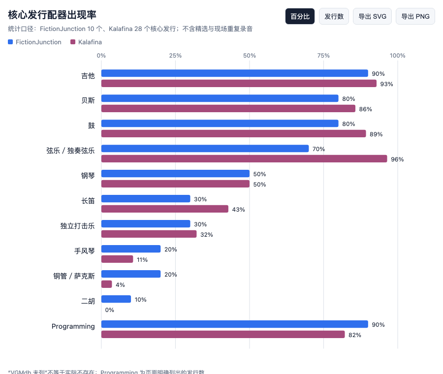
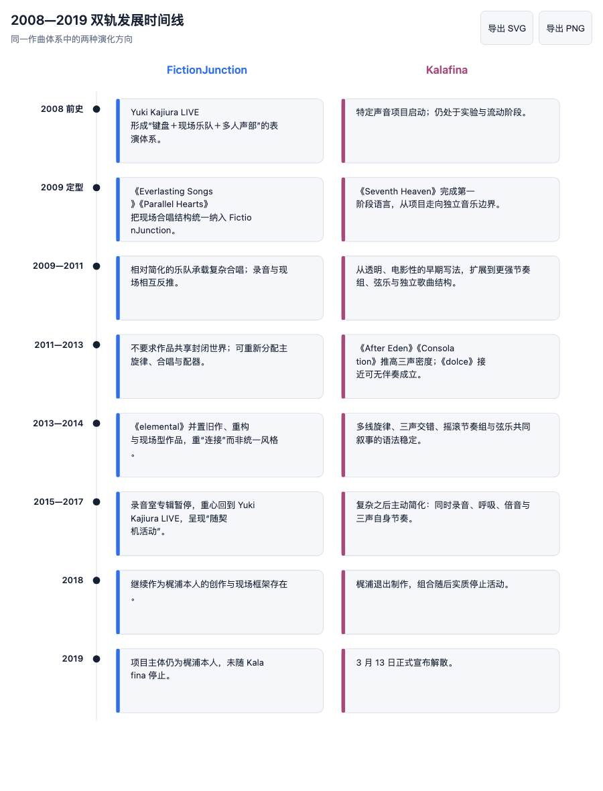
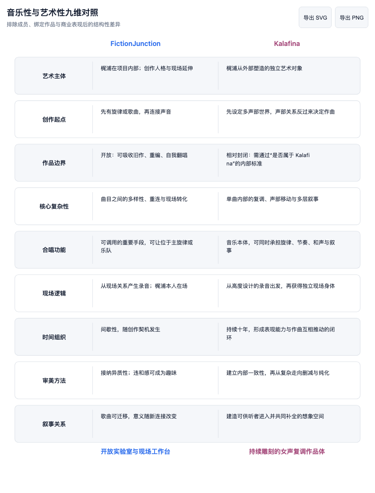

> 本文初稿建立于 2026 年 11 月 9 日。
>
> 资料分为两层：第一层是 VGMdb 的发行页、制作名单和逐曲 Notes；第二层是梶浦由记本人访谈、官方博客、官方声明及完整媒体访谈。分析有意排除成员身份、绑定作品和商业成绩，只讨论制作、配器、录音方法，以及音乐性和艺术性的结构差异。

把 FictionJunction 和 Kalafina 当成两个由同一位作曲家负责、风格略有不同的声乐组合，会从根本上误读梶浦由记的设计。

更准确的关系是：

- **FictionJunction 是梶浦本人置身其中的开放式创作接口。**歌曲先属于梶浦的作品体系，再根据作品需要连接主旋律、合唱、现场乐队或独奏者。它的艺术价值主要来自不同作品的重新组合、现场重构与持续试验。
- **Kalafina 是梶浦从外部塑造、并逐渐获得自身语法的封闭艺术实体。**它从特定的多声部声音构想出发，经过十年发展，最终形成只有这种复调结构才能成立的作曲方法。

一句话概括：

> **FictionJunction 是梶浦由记的音乐经过不同连接方式不断变形；Kalafina 是梶浦由记把一种特定的女声复调理想持续雕刻十年。**

## 研究口径

本文所说的 FictionJunction，主要指 2009 年《Everlasting Songs》《Parallel Hearts》之后形成的多人合唱形态，不把 FictionJunction YUUKA 当作主要比较对象。

同一张 Single 的普通版、初回版、动画版和黑胶版不重复计数；精选与正式现场音频专辑保留在资料范围内，但不重复计入配器出现率。第三方原声带与合辑不算组合自己的发行。

“VGMdb 未列”只代表页面没有填写相应资料，不代表实际不存在该乐器或工作人员。因此，下面的数字是**可验证的发行级下限**，不是对所有音轨的绝对统计。

## 配器首先暴露了最稳定的差异

去掉精选和现场重复录音后，统计对象包括 FictionJunction 的 10 个核心发行，以及 Kalafina 的 28 个核心发行。[^1][^2]

<iframe class="kajiu-viz instrumentation" src="/visuals/fictionjunction-kalafina/instrumentation-comparison.html" style="height:760px" loading="lazy" title="FictionJunction 与 Kalafina 核心发行配器出现率对比"></iframe>

<a href="/visuals/fictionjunction-kalafina/instrumentation-comparison.html" target="_blank">单独打开交互图</a>｜可切换百分比与发行数，并导出 SVG 或 PNG

查看静态 PNG

| 配器 | FictionJunction | Kalafina | 可以支持的判断 |
| --- | ---: | ---: | --- |
| 吉他 | 9/10，90% | 26/28，93% | 两者都以吉他为稳定骨架 |
| 贝斯 | 8/10，80% | 24/28，86% | 两者都长期使用现场低音乐器 |
| 鼓 | 8/10，80% | 25/28，89% | Kalafina 的节奏组配置略更固定 |
| 弦乐／独奏弦乐 | 7/10，70% | 27/28，96% | **最大的结构差异：弦乐几乎是 Kalafina 的常设层** |
| 钢琴 | 5/10，50% | 14/28，50% | 出现比例相同，具体功能不同 |
| 长笛 | 3/10，30% | 12/28，43% | Kalafina 更持续地叠加长笛音色 |
| 打击乐 | 3/10，30% | 9/28，32% | 比例接近 |
| 手风琴 | 2/10，20% | 3/28，11% | FictionJunction 的发行占比更高 |
| 铜管／萨克斯 | 2/10，20% | 1/28，4% | FictionJunction 更常把它作为项目性色彩 |
| 二胡 | 1/10，10% | 0/28 | 只在《circus》中明确出现 |
| Programming | 9/10 明列 | 23/28 明列 | 两者都以梶浦 Programming 作为电子与管弦底层 |

这组数字并不能直接证明哪一边“更古典”或“更摇滚”。真正可靠的结论是：**Kalafina 的弦乐—节奏组组合高度常态化，而 FictionJunction 更愿意让特定颜色乐器随项目出现或消失。**

## 编曲权其实高度集中

两边真正明确的“非梶浦编曲”都很少。

- FictionJunction《Everlasting Songs》的 M7 由 Koichi Korenaga 编曲，梶浦负责合唱编曲。[^3]
- Kalafina《Alleluia》的 M3—M4 是现场版本，由 Hiromitsu Ishikawa 负责 Live Arrangement。
- 《Winter Acoustic》是最重要的例外：Ishikawa 负责多首整曲或弦乐编配，Hirotaka Sakurada 负责部分钢琴编配，梶浦仍控制作品总体、合唱和 Programming。[^4]

所以，差异并不是“FictionJunction 由梶浦编、Kalafina 由别人编”。二者都由梶浦高度控制。区别在于：FictionJunction 允许作品根据现场和连接对象改变形态；Kalafina 则通常要求每次变化仍然通过一个稳定的内部声音标准。

## 同一个工程底盘，服务两套作曲语法

两个项目长期共享录音、混音工程师 Takashi Koiwa。梶浦在自己的博客中也特别称赞过他的混音，并提到现场影像的声音是一边对照画面一边完成的。[^5]

因此，两者的声音差异不能简单归因于不同录音师。Koiwa 更像共同的透明工程底盘：负责让高密度声部、乐队和弦乐保持清晰；真正决定声音方向的，是前面的作曲与声部组织。

母带环节反而更能看出制度差异：

- FictionJunction 使用过 Kazushige Yamazaki、Scott Hull、Andy VanDette 等多套体系，包含纽约 Masterdisk；
- Kalafina 早期以 Mitsuyasu Abe 为主，2009 年后长期固定为 Yuji Chinone 与 Sony Music Studios Tokyo。

FictionJunction 的工程链更随项目变化；Kalafina 的录音、混音和母带则更连续、更制度化。

## 2009 年并不是传统意义上的“成团”

FictionJunction 官方至今仍把它定义为梶浦由记的 solo project：正式成员只有梶浦本人，参与声音可以流动，并不是每首歌都必须由所有人参加。[^6]

因此，2009 年合唱型 FictionJunction 的形成，更准确的描述是：2008 年 Yuki Kajiura LIVE 中逐渐稳定的“键盘＋现场乐队＋多人声部”体系，在《Everlasting Songs》《Parallel Hearts》及随后的巡演中被统一冠以 FictionJunction 名义。

<iframe class="kajiu-viz timeline" src="/visuals/fictionjunction-kalafina/evolution-timeline.html" style="height:1180px" loading="lazy" title="FictionJunction 与 Kalafina 2008 至 2019 双轨发展时间线"></iframe>

<a href="/visuals/fictionjunction-kalafina/evolution-timeline.html" target="_blank">单独打开时间线</a>｜可导出 SVG 或 PNG

查看静态 PNG

这条时间线说明，FictionJunction 的发展不是一个固定组合持续建立统一语言，而是梶浦的作品、现场和参与声音不断发生新的连接。Kalafina 则经历了明确的内部演化：

1. 早期建立透明、神秘而电影性的声音世界；
2. 中期把三声复调、弦乐和节奏组推向更高密度；
3. 后期再主动剥离外部层次，检验三声结构自身能否成立。

## 梶浦本人怎么区分二者

2009 年《Parallel Hearts》时期，梶浦解释为什么不再使用“FictionJunction＋演唱者姓名”的命名：即使演唱者改变，基本上仍然是“自己作为主体”在做。她还说，平时写 FictionJunction 并不先考虑要给谁制造展示段落，而是先写自己认为美的旋律、自己认为美的歌曲，再请适合歌曲的声音完成。[^7]

这意味着 FictionJunction 的典型生成顺序是：

> 梶浦的旋律或作品 → 根据歌曲连接声音和声部 → 通过现场乐队重新实现

Kalafina 的起点正好不同。梶浦回顾最初构想时说，她先想建立一种特定的“Kalafina 音乐”，再去寻找能够实现它、彼此不同而独特的声音，同时不失去透明感。

到 2018 年，这种关系已经从单向制作变成互相推动。梶浦在 Oricon 访谈中说，早期确实是以歌曲为中心使用这些声音；但随着表现能力扩大，逐渐出现“这一段换成别的声音就不能成立”“如果不是这种声音关系，便写不出这首歌”的情况。她把这种相互推动称为一种“战斗”：表现能力提升得越多，自己的作曲方法也改变得越多。[^8][^9]

她最终把 Kalafina 称为自己“梦想的结晶”。从业余时期起，她就喜欢歌剧、合唱和女性声音的层叠，也曾为六人女声写无伴奏作品；但直到那个阶段，才真正具备实现这种音乐所需的作曲、编曲能力和创作自由。

## “我在里面还是外面”

2023 年《音乐 Natalie》回顾访谈中，梶浦给过一个最简洁的答案：Kalafina 与 FictionJunction 的区别，在于她本人是在里面还是在外面。[^10]

- Kalafina 之中没有梶浦本人，现场也不以她亲自演奏为必要条件；在艺术设定上，它应该能够脱离她的在场而运转。
- FictionJunction 因为梶浦本人就在内部，她忙碌时项目也无法活动，所以往往随着某种创作冲动或契机展开。

这里的“内／外”不是人员差异，而是两种创作主体性：**FictionJunction 是作曲家自身的延伸；Kalafina 是作曲家需要从外部面对、为其建立边界与连续性的艺术对象。**

## 两种不同的复杂性

FictionJunction 的复杂主要是横向的：不同作品、旧作、委托曲、现场版本和重新编配并置在一起。它不要求每首歌共享同一个封闭世界，甚至可以把“违和感本身”当作重新连接的趣味。

Kalafina 的复杂主要是纵向的：同一首歌里，多条旋律线和多个声部同时运动。单条主旋律往往不是完整作品，合唱也不只是背景，而可能同时承担旋律、节奏、和声与叙事。

梶浦谈《dolce》时说，这首歌几乎全程使用三声和声，像一首本来可以无伴奏演唱、后来才故意添加伴奏的作品。[^11]

<iframe class="kajiu-viz comparison" src="/visuals/fictionjunction-kalafina/artistic-comparison.html" style="height:1180px" loading="lazy" title="FictionJunction 与 Kalafina 音乐性和艺术性九维对照"></iframe>

<a href="/visuals/fictionjunction-kalafina/artistic-comparison.html" target="_blank">单独打开对照图</a>｜可导出 SVG 或 PNG

查看静态 PNG

## 录音与现场的方向相反

FictionJunction 很多时候是从现场经验生成录音。《Parallel Hearts》的制作过程就是：先在长期现场合作中发现多人合唱的力量，再把这种关系写成歌曲；现场乐队承担录音，器乐编曲保持相对直接，复杂性主要放在合唱组织上；完成后，作品再回到现场。

它的方向是：

> 现场经验 → 录音作品 → 再回到现场

Kalafina 早期更接近先在录音室设计高密度声部，再学习如何在现场实现。到 2016 年《Winter Acoustic》，方法才发生明显转折。Billboard 的访谈记载，梶浦希望得到现场的紧张感、乐器与声音之间的呼吸，以及能量碰撞产生的倍音，因此采用同时录音，而不是完全依靠逐轨精修。[^12]

2017 年的访谈又把这种变化概括为“变得更简单需要勇气”：去掉为了显得漂亮而添加的外部层次，露出最核心的结构；在没有节奏组时，由三声自身建立律动。[^13]

所以 Kalafina 的发展不是“简单 → 不断堆叠 → 越来越宏大”，而是：

> 建立世界 → 扩展复调和器乐密度 → 剥离外部层次，检验三声结构本身

## 《30th Anniversary Early BEST Collection for Soundtrack》曲目溯源

《30th Anniversary Early BEST Collection for Soundtrack / 梶浦由記》于 2023 年 12 月 6 日发行，编号 VTCL-60584～6，规格为 3CD，共 71 曲。FlyingDog 官方页面逐曲注明了选自哪张原始专辑；以下按“首次收入正式唱片”的年份整理。[^15][^16]

- 71 曲全部在 2023 年以前正式发行，没有为 Early BEST 新写或首次发表的曲目。
- 全部关联具体动画、OVA、游戏或音声企划；唯一不是影视／游戏的组别，是图画书《The Velveteen Rabbit》的朗读音声作品。
- 时间范围是 2001—2009 年，但没有选入 2003、2008 年首次发行的曲目。

### 首发年份分布

| 最早发行年份 | 曲目数 |
| --- | ---: |
| 2001 | 11 |
| 2002 | 12 |
| 2004 | 15 |
| 2005 | 15 |
| 2006 | 9 |
| 2007 | 4 |
| 2009 | 5 |
| **合计** | **71** |

### Disc 1：2001—2002

| 曲序与歌曲 | 最早发行与原始专辑 | 关联作品 | 说明 |
| --- | --- | --- | --- |
| 1–4、6、8 canta per me；snow；lullaby；salva nos；romance；chloe | 2001 《NOIR ORIGINAL SOUNDTRACK I》 | 电视动画《NOIR》 | 2001-06-21 发行 |
| 5、7、9–11 le grand retour；secret game；colosseum；maze；a farewell song | 2001 《NOIR ORIGINAL SOUNDTRACK II》 | 电视动画《NOIR》 | 2001-10-03 发行 |
| 12 SOUND DECLARATION of AQUARIAN AGE | 2002 最早收入《SPHERE.1 Influential ARAYASHIKI》等 SPHERE 系列唱片 | 电视动画《Aquarian Age: Sign for Evolution》 | SPHERE.1、2、3 于 2002-01-23 同日发行；该曲为 SPHERE 1–5 共用项目曲 |
| 13–14 KYOTA；DARKLORE | 2002 《Aquarian Age: Sign for Evolution ORIGINAL SOUNDTRACK》 | 同上 | 2002-02-21 发行 |
| 15–17、19 the world；aura；b.t.；a stray child | 2002 《.hack//SIGN ORIGINAL SOUND & SONG TRACK 1》 | 电视动画《.hack//SIGN》 | 2002-07-24 发行 |
| 18、20 bear；in the land of twilight, under the moon | 2002 《.hack//SIGN ORIGINAL SOUND & SONG TRACK 2》 | 同上 | 2002-09-21 发行 |
| 21–23 sweet memories；liminality#full version；grandpa's violin | 2002 《.hack//Liminality ORIGINAL SOUNDTRACK》 | OVA《.hack//Liminality》 | 2002-09-21 发行 |

### Disc 2：2004—2006

| 曲序与歌曲 | 最早发行与原始专辑 | 关联作品 | 说明 |
| --- | --- | --- | --- |
| 1–3 in the beginning, there was....；fatal fight (Jin & Margulis)；lamentation | 2004 《Xenosaga II MOVIE SCENE SOUNDTRACK》 | PS2 游戏《Xenosaga Episode II: Jenseits von Gut und Böse》 | 2004-07-07 发行；主要收录梶浦负责的剧情动画音乐 |
| 4–10 hepatica (Kos-Mos)；we've got to believe in something；she's coming back；battleland；godsibb；testament；the battle of your soul | 2006 《Xenosaga III: Also Sprach Zarathustra ORIGINAL SOUND BEST TRACKS — Yuki Kajiura Selection》 | PS2 游戏《Xenosaga Episode III: Also sprach Zarathustra》 | 第三部游戏录音，不是 2004 年《Xenosaga II》的续盘 |
| 11–12 Margalet；Elenore | 2004 《MADLAX O.S.T.》 | 电视动画《MADLAX》 | 2004-07-21 发行 |
| 13–15 Madlax；we're gonna groove；we are one | 2004 《MADLAX O.S.T.2》 | 同上 | 2004-09-22 发行 |
| 16–17 小さな祈り；ほんとうのもの～森の中へ | 2004 《Fantasy Sound & Reading: The Velveteen Rabbit／ビロードうさぎ》 | 图画书《The Velveteen Rabbit》的日语朗读／音声剧企划 | 2004-12-16 发行；不是影视／游戏 tie，但仍是具体文学改编音声作品的配乐 |
| 18–22 媛星；今日の始まり；鴇色の舞；デュラン召還；目覚め | 2004 《TV ANIMATION 舞-HiME ORIGINAL SOUNDTRACK Vol.1 姫》 | 电视动画《舞-HiME》 | 2004-12-22 发行 |
| 23–24 希望の都、ヴィントブルーム；MATERIALISE | 2005 《舞-乙HiME ORIGINAL SOUNDTRACK Vol.1 乙女の花園》 | 电视动画《舞-乙HiME》 | 2005-12-21 发行 |

### Disc 3：2005—2009

| 曲序与歌曲 | 最早发行与原始专辑 | 关联作品 | 说明 |
| --- | --- | --- | --- |
| 1–8 a song of storm and fire；believe；dewdrops；I talk to the rain；ship of fools；hear our prayer；guess how much I love you；best years in our lives | 2005 《Tsubasa Chronicle Original Soundtrack — Future Soundscape I》 | NHK 电视动画《翼·年代记》 | 2005-07-06 发行 |
| 9–10 voices silently sing；blue clouds | 2005 《Tsubasa Chronicle Original Soundtrack — Future Soundscape II》 | 同上 | 官方页及编号 VICL-61662 均指向 II；VGMdb Early BEST Notes 曾误写 III |
| 11–12 once upon a time there was you and me；ring your song | 2006 《Tsubasa Chronicle Original Soundtrack — Future Soundscape IV》 | 同上 | 2006-09-21 发行 |
| 13–15 天翔；everlasting song；目覚めの朝 | 2005 《Erementar Gerad / Elemental Gelade Original Soundtrack 1》 | 电视动画《Elemental Gelade／武器种族传说》 | 2005-04-21 发行；这里的 everlasting song 是英文原声曲，不是 2009 年日语重构版 |
| 16–17 el cazador；hit it and run! | 2007 《EL CAZADOR DE LA BRUJA ORIGINAL SOUNDTRACK 1》 | 电视动画《El Cazador de la Bruja》 | 2007-07-25 发行 |
| 18–19 carnaval in blue；paradise regained | 2007 《EL CAZADOR DE LA BRUJA ORIGINAL SOUNDTRACK 2》 | 同上 | 2007-09-21 发行 |
| 20–23 Pandora hearts；Melody；Contractor；Bloody rabbit | 2009 《Pandora Hearts ORIGINAL SOUNDTRACK 1》 | 电视动画《Pandora Hearts》 | 2009-07-08 发行 |
| 24 Limits | 2009 《Pandora Hearts ORIGINAL SOUNDTRACK 2》 | 同上 | 2009-09-30 发行；是本精选年代最晚的一批 |

### 作品覆盖摘要

| 作品 | 最早年份 | 收录曲数 |
| --- | ---: | ---: |
| NOIR | 2001 | 11 |
| Aquarian Age: Sign for Evolution | 2002 | 3 |
| .hack//SIGN | 2002 | 6 |
| .hack//Liminality | 2002 | 3 |
| Xenosaga Episode II | 2004 | 3 |
| Xenosaga Episode III | 2006 | 7 |
| MADLAX | 2004 | 5 |
| The Velveteen Rabbit 音声剧 | 2004 | 2 |
| 舞-HiME | 2004 | 5 |
| 舞-乙HiME | 2005 | 2 |
| 翼·年代记 | 2005–2006 | 12 |
| Elemental Gelade | 2005 | 3 |
| El Cazador de la Bruja | 2007 | 4 |
| Pandora Hearts | 2009 | 5 |

## 最终区别

**FictionJunction 的艺术性在于“连接”。**它把梶浦由记不同时期、不同来源、不同编制的音乐重新放入同一个活的表演系统。统一性来自梶浦本人，而不是固定的作品边界。

**Kalafina 的艺术性在于“生成世界”。**它把多条声部当作真正的作曲材料，让旋律、和声、器乐与叙事共同生成一个只能由这种语法成立的空间。

2019 年解散声明中，梶浦回顾说，Kalafina 的音乐也许不是只供人聆听，而是需要听者运用想象力，一边编织自己的故事，一边进入音乐；这个世界并不只由制作方完成，听者的参与也使它继续进化。[^14]

所以，两者不是“同一位作曲家给两个组合写了不同风格的歌”，而是梶浦由记对作品与创作者关系的两种回答：

> **FictionJunction：作品始终围绕创作者流动。**
>
> **Kalafina：创作者逐渐把作品推离自己，使其形成自己的生命。**

## 参考来源

[^1]: [VGMdb：FictionJunction 艺人页与发行目录](https://vgmdb.net/artist/8501)
[^2]: [VGMdb：Kalafina 艺人页与发行目录](https://vgmdb.net/artist/7699)
[^3]: [VGMdb：《Everlasting Songs》制作名单与逐曲 Notes](https://vgmdb.net/album/38742)
[^4]: [VGMdb：《Winter Acoustic “Kalafina with Strings”》制作与编曲名单](https://vgmdb.net/album/61461)
[^5]: [梶浦由记官方博客：《輝く空の静寂には》](https://fictionjunction.com/blog/%E8%BC%9D%E3%81%8F%E7%A9%BA%E3%81%AE%E9%9D%99%E5%AF%82%E3%81%AB%E3%81%AF/)
[^6]: [FictionJunction 官方：FictionJunction とは](https://fictionjunction.com/aboutfictionjunction/)
[^7]: [Animate Times：2009 年《Parallel Hearts》梶浦由记访谈](https://www.animatetimes.com/news/details.php?id=1241740826)
[^8]: [Oricon：2018 年梶浦由记回顾 Kalafina 的访谈原址](https://www.oricon.co.jp/news/2114546/full/)
[^9]: [Oricon 访谈完整英文存档](https://canta-per-me.net/yuki-kajiura/interviews/yuki-kajiura-interview-on-oricon-after-leaving-spacecraft-about-kalafina/)
[^10]: [音乐 Natalie：梶浦由记 30 周年与 FictionJunction《PARADE》访谈（2/3）](https://natalie.mu/music/pp/kajiurayuki02/page/2)
[^11]: [梶浦由记官方博客：《アレルヤ》与《dolce》的创作说明](https://fictionjunction.com/blog/%E3%82%A2%E3%83%AC%E3%83%AB%E3%83%A4/)
[^12]: [Billboard Japan：2017 年《百火撩乱》访谈](https://www.billboard-japan.com/special/detail/2067)
[^13]: [SPICE：Kalafina 9 周年“变得更简单需要勇气”访谈](https://spice.eplus.jp/articles/101777)
[^14]: [SPICE：2019 年解散声明与梶浦由记完整评论](https://spice.eplus.jp/articles/231047)
[^15]: [FlyingDog：Early BEST 官方发行公告及逐曲源专辑](https://www.jvcmusic.co.jp/-/News/A016061/28.html)
[^16]: [VGMdb：Early BEST 完整曲序、Credits 与作品对应](https://vgmdb.net/album/132793)
